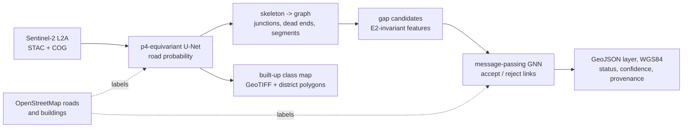
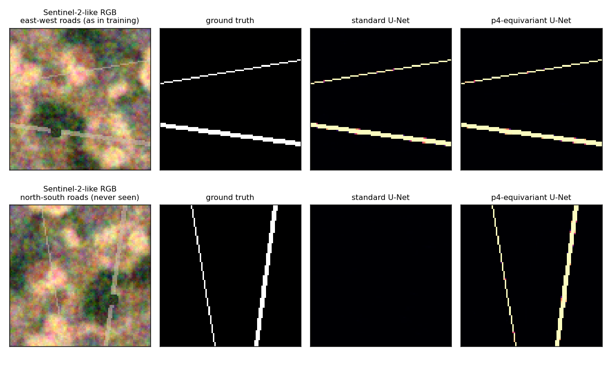
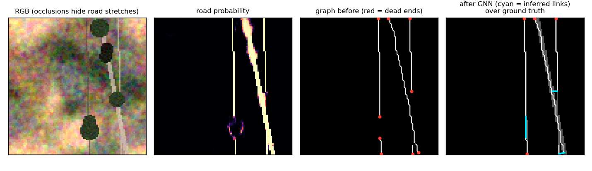
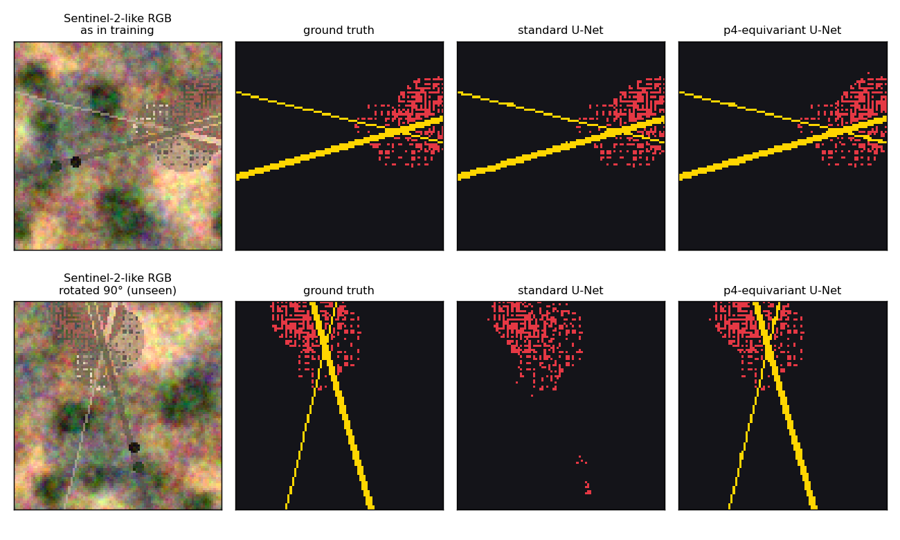
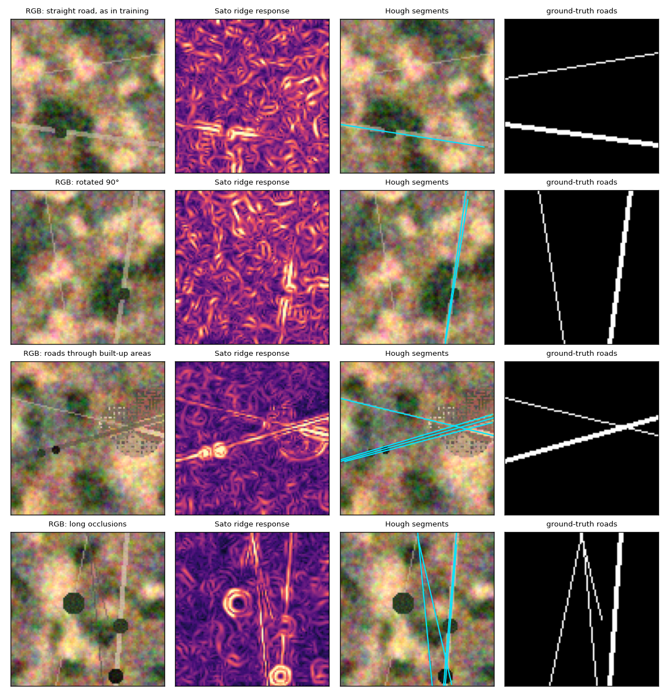
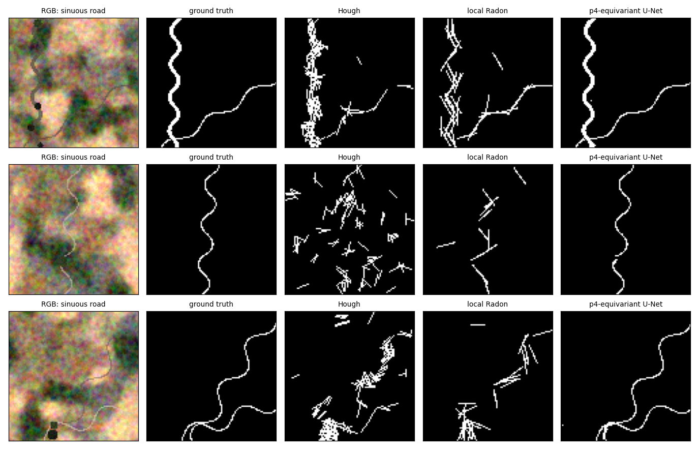
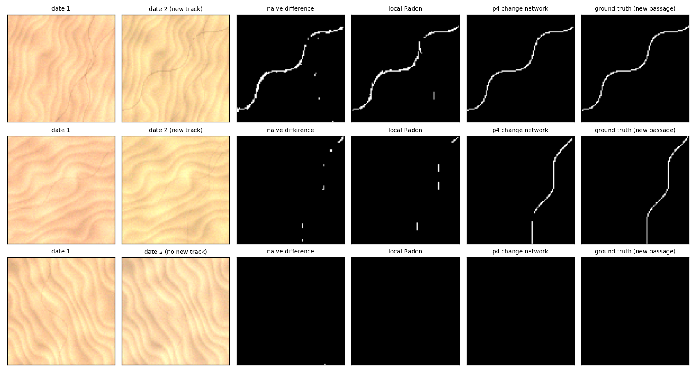

# geo-equivariant-roads

**Road network and built-up area extraction, and detection of new tracks across dunes, from Sentinel-2 imagery. Built on a rotation-equivariant CNN and a message-passing GNN that repairs the road network's topology, and benchmarked against classical Hough and Radon detectors.**

The repository explores two ideas for automatic cartography from satellite imagery:

1. **Symmetry belongs in the architecture.** Overhead imagery has no canonical orientation: a road is a road whatever its heading. A p4-equivariant network guarantees, by construction, that rotating the input rotates the output. A standard CNN has to learn this from data, and fails on orientations it has not seen.
2. **A map is a graph, and its value lies in its topology.** A road network cut by a 30 m gap under tree canopy still looks fine pixel-wise, but routing across it is impossible. A message-passing GNN reasons over the extracted graph to decide which gaps are real roads.

Everything runs on CPU, is covered by unit tests, and the experiments below are reproducible with one command.



## Results (synthetic Sentinel-2-like tiles)

`python scripts/run_experiment.py` (experiments A and B) and `python scripts/run_multiclass.py` (experiment C) reproduce everything in about 30 minutes on a laptop CPU, `python scripts/run_hough.py` (experiment D, classical baseline) in about 3 more, and `python scripts/run_tracks.py` (experiments E and F) in about 25 more. The numbers below are copied from `results/results.json`, `results/results_multiclass.json`, `results/results_hough.json` and `results/results_tracks.json`.

### A. Generalisation to unseen orientations

Both networks are trained only on roads running within ±20° of east-west, with the same parameter budget and no rotation augmentation. They are then tested on east-west roads, on the same tiles rotated by 90° (north-south roads), and on roads of any heading. Metric: relaxed F1 with a 1-pixel tolerance.

| Model | Parameters | East-west (as trained) | North-south (unseen) | Any heading |
|---|---:|---:|---:|---:|
| Standard U-Net | 488,849 | 0.999 | **0.012** | 0.596 |
| p4-equivariant U-Net | 487,497 | 0.999 | **0.999** | 0.874 |



The standard U-Net detects east-west roads perfectly and **misses north-south roads entirely**: it learned "a road is a bright east-west line". The equivariant network gives identical results for 90° rotations by construction (a theorem, checked by `tests/test_equivariance.py`, not a training outcome). On arbitrary headings it reaches 0.874 against 0.596: much better, but not perfect, because exact equivariance only holds for multiples of 90° and diagonal headings were never seen in training (see *Limitations*).

### B. Topology repair with message passing

The segmentation network is trained with moderate occlusions, then applied to tiles with long occlusions (rows of trees, shadows, sand drifts) that it cannot bridge on its own. Candidate links are generated from every dead end, and three strategies are compared on 80 test tiles. Both the GNN and the rule have their acceptance threshold tuned on the 200 training tiles.

APLS is reported with its two directions. **Completeness** measures how well the true routes are reproduced by the extracted network (GT → prediction). **Correctness** measures whether the routes of the extracted network really exist (prediction → GT): a false link creates phantom routes.

| Repair strategy | APLS-lite | Completeness | Correctness | \|#components − GT\| ↓ | Link precision | Link recall | Link F1 |
|---|---:|---:|---:|---:|---:|---:|---:|
| None | 0.855 | 0.802 | **0.947** | 0.78 | — | — | — |
| Rule: distance × alignment | 0.861 | 0.911 | 0.843 | **0.29** | 0.615 | 0.359 | 0.453 |
| Message-passing GNN | **0.864** | **0.917** | 0.843 | 0.30 | **0.715** | **0.574** | **0.637** |


*Illustrative tile: inferred links (cyan) close gaps hidden by occlusions.*

What this shows:

- **Pixel metrics hide topology errors.** Segmentation still reaches a relaxed F1 of 0.977 on these tiles, yet one route in five is broken (completeness 0.80).
- **Repair restores routing**: completeness rises from 0.80 to 0.92, and the network is far less fragmented.
- **The GNN makes better decisions than the rule**: +18 points of link F1, +10 points of precision and +21 points of recall.
- **The headline APLS barely moves** (0.855 → 0.864), and this is the most instructive result. Every false link (about 30 % of accepted links) opens phantom routes, so correctness drops by as much as completeness gains. On a GEOINT product the trade-off must be explicit. This is why inferred links are exported with `status: inferred` and a confidence: an analyst can filter them, or a stricter threshold can favour correctness. Better link precision is the main lever for improvement (see *Limitations*).

### C. Roads and built-up areas together

Same protocol as experiment A, with a three-class head (background, road, built-up). Built-up areas are districts of 1-3 px roofs separated by streets and gardens, placed along the roads.

| Model | Roads F1, east-west | Roads F1, north-south | Built-up IoU, east-west | Built-up IoU, north-south |
|---|---:|---:|---:|---:|
| Standard U-Net | 0.994 | **0.004** | 0.859 | **0.531** |
| p4-equivariant U-Net | 0.995 | **0.995** | 0.900 | **0.900** |



The standard U-Net also loses more than a third of its built-up IoU on rotated scenes, even though the roof blocks themselves look the same after rotation. Part of what it learned about "built-up" depended on context: the orientation of the roads serving the districts. The equivariant network is immune to this failure by construction.

Outputs for analysts (samples in `docs/`): a class map GeoTIFF with a colour table (`sample_classes.tif`), and built-up **district polygons** in WGS84 (`sample_built_up.geojson`). Blocks separated by streets of up to 20 m are merged into one district, and each polygon carries its envelope area, the roof area actually detected inside it, a mean confidence and its provenance.

### D. Classical baseline: Hough transform

Before deep learning, linear structures were detected with a ridge filter followed by a Hough transform, and this remains a strong, fully explainable reference. The pipeline in `src/eqroads/hough.py` works as follows:
1. a multi-scale Sato ridge filter is applied to mean visible brightness and to near-infrared;
2. the response is thresholded at a percentile;
3. a probabilistic Hough transform turns the remaining pixels into line segments.

Its four parameters were tuned by grid search on 40 training tiles from the same east-west distribution as the networks. The grid was widened until the optimum stopped improving, and several pre-processing variants were tried, keeping the best one. It runs on the exact test sets of experiments A, B and C (`python scripts/run_hough.py`).

| Test | Hough transform | Standard U-Net | p4-equivariant U-Net |
|---|---:|---:|---:|
| A. Roads F1, east-west | 0.809 | 0.999 | **0.999** |
| A. Roads F1, north-south (unseen) | 0.815 | 0.012 | **0.999** |
| A. Roads F1, any heading | 0.792 | 0.596 | **0.874** |
| C. Roads F1 among built-up areas, east-west / north-south | 0.806 / 0.813 | 0.994 / 0.004 | **0.995 / 0.995** |
| B. Long occlusions: APLS-lite (completeness / correctness) | 0.545 (0.507 / 0.716) | — | **0.855** (0.802 / 0.947), 0.864 with GNN repair |
| CPU time per 96 × 96 tile, one thread | 0.065 s | — | 0.080 s |



What this shows:

- **Hough is orientation-invariant by nature, and that matters.** It votes over all directions with equal weight, so its scores are the same for east-west and north-south roads. Out of distribution it beats the standard U-Net (0.815 against 0.012 on north-south roads, 0.792 against 0.596 on any heading). A classical method with the right prior is more robust than a deep network without it.
- **The equivariant network combines both advantages**: the symmetry prior of Hough and the accuracy of learning (0.999 against 0.81). It has no explicit line model, so the same network also maps built-up areas, which Hough cannot do.
- **Hough misses faint roads and produces parallel duplicates.** It finds wide roads cleanly and bridges occlusions thanks to its large tolerated gap, but it misses 1-pixel roads with weak contrast (completeness 0.51) and adds parallel lines on the road flanks. Its topology is therefore much weaker (APLS 0.545 against 0.855). The graph is extracted after a 1-pixel dilation that merges those duplicates, which is a favourable post-processing step for Hough.
- **The cost is comparable on CPU** (0.065 s against 0.080 s per tile). On a GPU the network would be far faster, while the Hough transform does not benefit much from one.
- **The test favours Hough.** Synthetic roads are perfectly straight lines, which is exactly the Hough model. On real roads (curves, roundabouts, interchanges, desert tracks) its performance would drop, whereas the networks make no assumption about road shape.

### E. Sinuous roads: where line detectors break down

Hough and Radon look for straight lines; mountain roads, wadi tracks and desert pistes are not straight. The test tiles contain only roads whose heading oscillates by 25-60° every 25-60 px. Every method, the network included, was tuned or trained on a 50/50 mix of straight and sinuous roads. The classical grids were widened until no parameter sat on a grid boundary.

| Method | F1, straight roads | F1, sinuous roads | APLS, sinuous roads (completeness / correctness) |
|---|---:|---:|---:|
| Hough transform | 0.545 | 0.602 | 0.380 (0.326 / 0.590) |
| Localised Radon transform | 0.714 | 0.689 | 0.411 (0.376 / 0.555) |
| p4-equivariant U-Net | **0.998** | **0.997** | **0.936** (0.929 / 0.953) |



- **Line detectors approximate a curve with a cloud of short segments.** To follow bends, Hough has to accept very short segments with almost no gap tolerance (5 px, 3 px), which also makes it worse on straight roads than when it is tuned for them (0.545 against 0.809 in experiment D). The resulting map is a scatter of fragments, and the topology scores show it (APLS 0.38).
- **The localised Radon transform follows curves better** because each window only needs the road to be straight locally. It still produces one line per window, broken at window boundaries.
- **The network makes no assumption about shape** and gives the same quality on straight and sinuous roads.

### F. Monitoring a passage: a new track across dunes

The question is no longer "where is the road?" but "**has anyone driven through here since the last acquisition?**" Each test case is a pair of acquisitions of the same desert area (`src/eqroads/dunes.py`):
- asymmetric, sinuous dune crests **migrate** by 0.3-1 px between the two dates;
- the radiometric gain changes from one date to the next;
- **older tracks** are visible on both dates and must not raise an alert;
- in half of the pairs, a **new sinuous track** appears on the second date. It darkens the sand by only 4-12 % (a per-pixel signal of about 2.8 noise standard deviations), is partly covered by drifting sand, and half the time runs along the interdune corridor, parallel to the clutter.

Four detectors work on the two dates:
- **naive difference**: thresholded, smoothed difference between the two dates;
- **Hough**: Hough transform on that difference;
- **localised Radon transform**: the classical detector of ship wakes in SAR imagery, including the faint wakes of small low-profile craft, applied to the difference;
- **p4-equivariant change network**: receives the 8 bands of both dates and outputs a map of new passages.

All four are tuned (or trained) on separate pairs and evaluated on 80 balanced test pairs. Tile-level scores rank the tiles; "false-alert tiles" is the share of pairs *without* a new track where the method, at its tuned operating threshold, flags 10 pixels or more.

| Method | Pixel F1 on new tracks | False-alert tiles ↓ | Tile AUC | Detection rate at 5 % false alarms | CPU s / tile |
|---|---:|---:|---:|---:|---:|
| Naive difference | 0.694 | 37.5 % | 0.999 | 1.00 | 0.001 |
| Hough on the difference | 0.741 | 97.5 % | 0.914 | 0.73 | 0.001 |
| Localised Radon on the difference | 0.728 | 32.5 % | 0.983 | 0.95 | 1.88 |
| p4-equivariant change network | **0.989** | **7.5 %** | **0.999** | **1.00** | 0.076 |


*Row 2: a very faint track that neither the difference nor Radon picks up; the network follows it almost entirely. Row 3: older tracks only, no alert.*

What this shows:

- **Detecting that something happened is easy; saying where without false alerts is hard.** Even the naive difference ranks tiles almost perfectly (AUC 0.999), because a new track is the strongest change in the scene. But at an operating threshold that maps the track, it raises an alert on more than a third of empty tiles: the migrating crests leave crest-shaped residues in the difference.
- **Radon is the right tool on a homogeneous background, not on linear clutter.** On the sea, a wake is the only long straight structure, and integrating along it lifts it out of speckle. In dunes, migration produces straight residues as well, and the tracks bend. Radon therefore performs best with its smallest window (8 px), giving up the long integration that makes it powerful. It still beats the naive difference on false alerts (32.5 % against 37.5 %), at a high computing cost.
- **Hough on the difference latches onto crest residues** (false alerts on almost every empty tile).
- **The change network sees both dates together** rather than their difference alone. It can therefore learn what dune migration looks like (a shift of the whole crest pattern) and tell it apart from a new dark line. It cuts false alerts by a factor of four to five while recovering almost the whole track. Its near-perfect scores mostly reflect the simplicity of synthetic data: on real imagery the gap between methods will narrow, and its size has to be measured.

**Sensor choice for this use case.** At 10 m, Sentinel-2 only shows a piste once repeated passages have built up contrast along its length. To detect **new ground disturbance** (a single vehicle passage, a bivouac, fresh tracks), the operational technique is **SAR coherent change detection**. It looks for a loss of interferometric coherence between two Sentinel-1 passes: the surface has been disturbed even if nothing is visible. VHR optical imagery (≤ 1 m) is the alternative. The same code applies: coherence pairs or VHR pairs replace the Sentinel-2 bands as input to the change network. The localised Radon transform stays useful on homogeneous backgrounds (sea, flat regs), where its integration gain is fully available.

## Why message passing: the link with belief propagation

Each GNN layer runs the three steps of message passing: every edge computes a message from its two end nodes, every node aggregates its incoming messages, and nodes and edges update their states (`src/eqroads/gnn.py`).

This is the learned counterpart of **belief propagation**, the algorithm that decodes LDPC and turbo codes in every 4G/5G modem. Variable and check nodes of the code's factor graph exchange log-likelihood messages iteratively, with one rule that carries over directly: a node never sends back to a neighbour the information it received from it (the *extrinsic information* of turbo decoding). In belief propagation the update rules are fixed and derived from probabilities. Here they are learned, which makes them usable on road graphs where no explicit probabilistic model exists. The per-edge hidden states play the role of BP's edge messages: they let competing candidates at the same dead end inhibit each other.

## Engineering choices

- **Equivariance is exact and tested.** p4 rotations map the pixel grid onto itself, so the layers need no interpolation. The tests check equivariance layer by layer and for the whole U-Net, and check that a standard U-Net does *not* have the property (so the test is not trivially true).
- **The GNN is rotation-invariant by construction.** Its inputs are distances, cosines between directions and probabilities sampled along segments, never absolute coordinates. A dedicated test rotates a full scene and checks that every feature is unchanged. That test caught a real bug: rounding sample points to the nearest pixel broke the symmetry on ties, and bilinear sampling fixed it.
- **Metrics follow SpaceNet practice.** Pixel F1 uses a tolerance, as is standard for thin structures. APLS-lite injects control points every 100 m along edges and snaps them to the nearest point of the other graph. The simplification against official APLS is that it uses random pair sampling instead of all pairs.
- **The output is map-ready.** The GeoJSON is reprojected from the scene's UTM zone to WGS84 (RFC 7946). Each segment is marked `detected` or `inferred`, with a confidence, its length in metres, the source scene and the model version, which gives an audit trail for every line on the map (sample: `docs/sample_output.geojson`).
- **Tests guard the data, not just the model.** A first version of the synthetic generator clipped road endpoints coordinate by coordinate, which bent roads towards the tile corners and silently widened the "east-west only" training set. It was caught by looking at a figure, fixed with proper segment clipping (Liang-Barsky), and is now covered by a regression test. All results above were produced after the fix.
- **The experiments are reproducible**: fixed seeds, one command per experiment, CI on every push (lint, 29 unit tests, end-to-end smoke runs, Hough baseline).

## Real Sentinel-2 data

```bash
pip install -e ".[real,viz]"
python scripts/fetch_s2.py --buildings --out data/abu_dhabi.npz          # default AOI: Abu Dhabi mainland
python scripts/train_real.py --multiclass --tiles data/*.npz --steps 4000  # GPU recommended
python scripts/infer.py --tile data/abu_dhabi.npz --weights results/real --out outputs/abu_dhabi
# -> outputs/abu_dhabi_roads.geojson, abu_dhabi_built_up.geojson, abu_dhabi_classes.tif
```

- **Imagery** is found by a STAC search (Microsoft Planetary Computer, `sentinel-2-l2a`) filtered on cloud cover. The 10 m bands B02, B03, B04 and B08 are read directly from Cloud-Optimised GeoTIFFs with windowed requests: only the area of interest is downloaded. The `-1000` reflectance offset introduced with processing baseline 04.00 is handled.
- **Clouds and shadows** are excluded through the SCL scene classification layer, and the resulting validity mask weights the loss.
- **Road labels** come from OpenStreetMap roads. They are reprojected to the scene CRS, buffered in metres according to road class, and rasterised on the exact Sentinel-2 grid.
- **Built-up labels** come from OpenStreetMap building footprints. They are rasterised on a 2 m grid and averaged back to 10 m, which gives each pixel its true roof coverage fraction: a 12 × 15 m villa is neither lost nor inflated to whole pixels. A pixel is labelled built-up above 30 % coverage (`--built-up-threshold`), and roads take precedence.

**Know the sensor's limits.** At 10 m resolution, Sentinel-2 reliably shows motorways, trunk roads and desert roads, not residential streets. It maps **built-up areas, not individual houses**: a villa covers one or two pixels mixed with its surroundings. OSM labels also contain roads that are invisible in the image (under canopy, in tunnels), and OSM building coverage varies by region. The pipeline is meant for regional mapping and change monitoring (urban growth, new road corridors). For street-level and building-level mapping, the same code applies to sub-metre imagery (SpaceNet, commercial VHR).

## Limitations and next steps

- **Exact equivariance only for 90° rotations.** Accuracy on arbitrary headings (0.874) shows the gap. Extending to C8 or SO(2) with steerable filters (e.g. `escnn`) would cover diagonal roads exactly.
- **Link precision limits the topology gain.** Ideas: richer edge features (spectral profile along the gap, occlusion likelihood), a joint decision over all candidates of a dead end (closer still to belief propagation), and training directly on an APLS-aware objective.
- **The headline results are on synthetic data.** The real-data path (`fetch_s2`, `train_real`, `infer`) is complete but not yet benchmarked. Next step: a held-out evaluation over several Emirates AOIs against OSM roads and buildings.
- **The GNN only adds links.** Removing false positives (spurious segments) and regularising junction geometry are natural extensions of the same edge-classification setup.
- **The change network runs on synthetic pairs only.** On real data it needs two co-registered acquisitions of the same AOI (`fetch_s2.py` with two date ranges) and labels of new tracks, which OSM does not provide. Analyst annotation or SAR-coherence-derived labels would be needed.
- **Further directions**: Sentinel-1 coherence as input for change detection, fusion of SAR (cloud-independent) and optical imagery, calibrated confidences, and change detection between dates by comparing road graphs.

## Repository layout

```
src/eqroads/
  p4conv.py     group-equivariant convolution layers (lifting, group conv, pooling)
  segnet.py     p4-equivariant U-Net and standard U-Net baseline
  graph.py      skeleton -> graph, gap candidates, invariant features, labels
  gnn.py        message-passing GNN (PyTorch Geometric)
  hough.py      classical baseline: Sato ridge filter + probabilistic Hough transform
  radon.py      localised Radon transform line detector (SAR ship-wake heritage)
  dunes.py      bi-temporal desert scenes: migrating dunes, old and new tracks
  tracks_eval.py  evaluation of experiments E (sinuous roads) and F (new tracks)
  metrics.py    relaxed F1, IoU, APLS-lite (completeness / correctness), connected components
  export.py     GeoJSON roads and built-up polygons (WGS84), class GeoTIFF, provenance
  data_s2.py    STAC / COG / SCL access, OSM road and building labels
  synthetic.py  Sentinel-2-like synthetic tiles (roads, built-up) for tests and experiments
  train.py      training loops, sliding-window inference, repair strategies
scripts/        run_experiment.py, run_multiclass.py, run_hough.py, run_tracks.py,
                fetch_s2.py, train_real.py, infer.py
tests/          equivariance, invariance, graph, metrics, multi-class, Hough, Radon, dunes and export tests
```

## Author

Antoine Damon. 25 years of signal processing and embedded R&D (cellular modem PHY, belief-propagation decoders, avionics), now working on geometric deep learning for geospatial intelligence. MIT licence.
